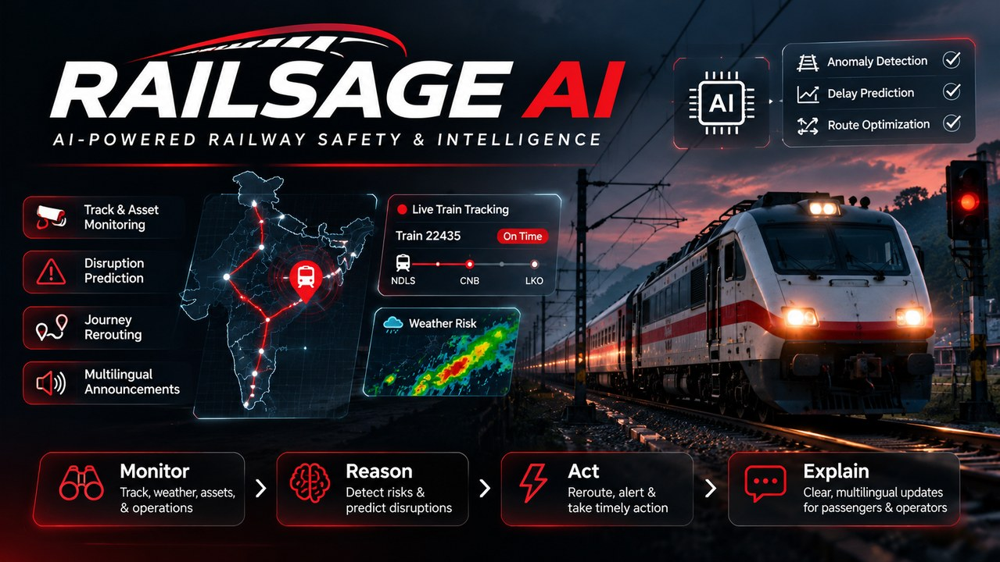
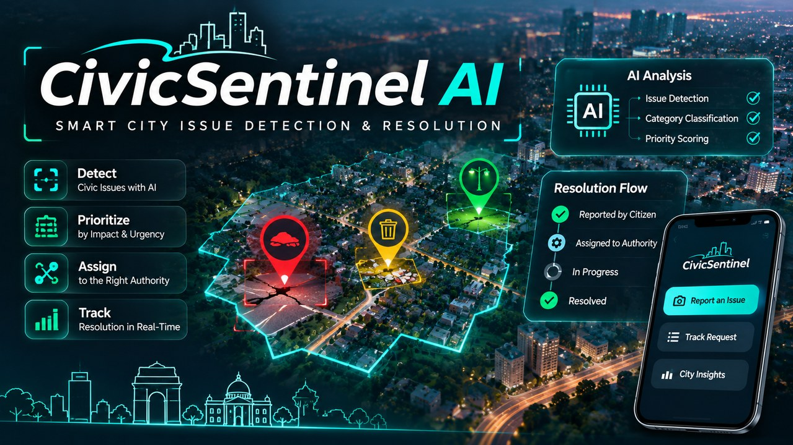
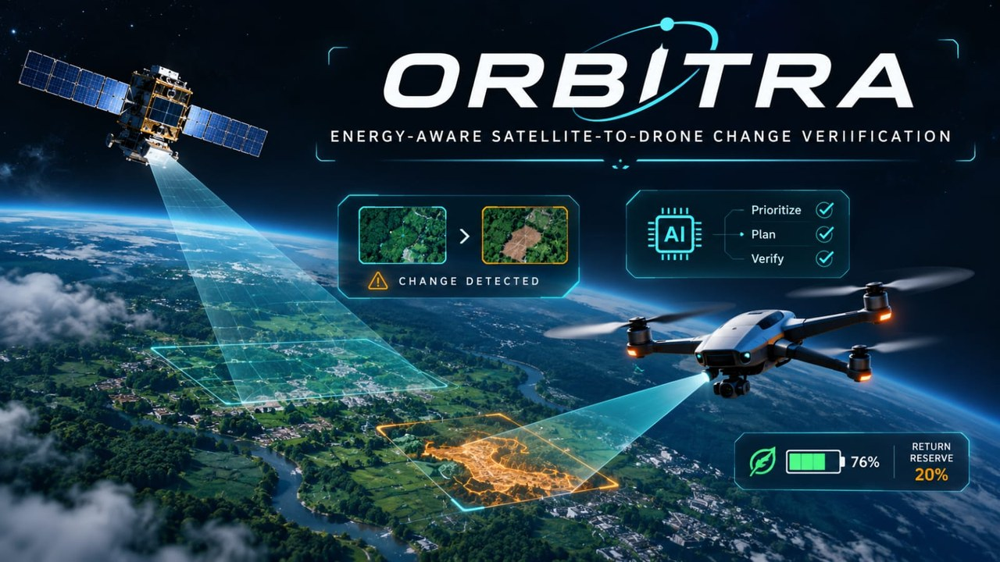
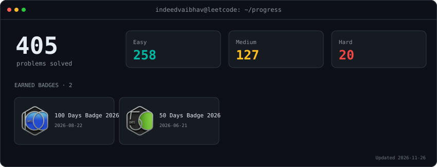

 

 

## 01 // Operator Profile

<table>
<tr>
<td width="40%" valign="top"></td>
<td width="60%" valign="top">

I’m a third-year **Computer Science & Engineering student at PSIT Kanpur**, building across Java, backend systems, full-stack products, and applied AI.

I like taking a real problem from **first sketch → working system**: model the data, shape the API, build the interface, then tighten the details.

**Current coordinates:** Java and DSA · Spring Boot and PostgreSQL · React and Next.js · AI/LLM applications · geospatial systems.

> **Build it. Understand it. Then make it better.**

</td>
</tr>
</table>

<table>
<tr>
<td width="25%" valign="top"><b>01 / SHIP</b> Turn ideas into usable software, not just slides.</td>
<td width="25%" valign="top"><b>02 / MODEL</b> Make the data and system boundaries clear.</td>
<td width="25%" valign="top"><b>03 / EXPLAIN</b> Keep AI-assisted decisions understandable.</td>
<td width="25%" valign="top"><b>04 / REFINE</b> Learn from the first version and improve it.</td>
</tr>
</table>

## 02 // Animated Readouts

## 03 // Systems in the Field

### RailSage AI · Railway Operations

Team project for **FAR AWAY Hackathon 2026**. An operator-facing dashboard with live map tracking, multilingual announcements, and a step-by-step Claude reasoning feed.

**React 19 · Vite · Node.js · Express · Leaflet · GSAP**

[Live demo](https://railsage-ai.vercel.app) · [Source](https://github.com/indeedvaibhav/railsage-ai)

 

### CivicSentinel · Civic Intelligence

Citizen and admin workflows for civic complaints, AI-assisted classification, location-aware operations, and information retrieval.

**Civic tech · AI/LLM · RAG concepts · Geospatial data**

 

### GramSetu · Village Infrastructure

A village-infrastructure digital twin concept for Panchayat planning, combining village-level data, analytics, and geospatial context.

**Decision support · Data visualization · Maps**

 

### Orbitra · Satellite-to-Drone Verification

An energy-aware satellite-to-drone change-verification concept, shown with before/after imagery, AI-assisted prioritization, mission planning, and battery reserve awareness.

**Satellite change verification · AI-assisted planning · Energy-aware missions**

<b>More builds</b> · ParkSense · eSwasthya · VarshaDrishti · Portfolio

- **ParkSense** — parking management workflows with a React/Next.js frontend and Spring Boot backend.
- **eSwasthya** — voice-first, multilingual healthcare interface concept focused on accessible navigation.
- **VarshaDrishti** — data and visualization project focused on turning information into useful insights.
- **Personal portfolio** — Next.js and TypeScript. [Live site](https://vaibhav-portfolio-o412.vercel.app/) · [Source](https://github.com/indeedvaibhav/poertfolio)

## 04 // Toolchain

## 05 // Telemetry

<a href="https://leetcode.com/u/Indeedvaibhav/">Open LeetCode profile ↗</a>

## 06 // Base + Current Direction

| Base | Current focus |
|:---|:---|
| **B.Tech, Computer Science & Engineering** · PSIT Kanpur | Java DSA · backend architecture · database design |
| **3rd year** · Kanpur, Uttar Pradesh, India | Spring Boot + PostgreSQL · React / Next.js |
| **Open to** internships, hackathons, and open-source collaboration | AI/LLM applications · RAG · geospatial systems |

## 07 // Make Contact

**Have a useful problem to solve or a team to build with?**

[Portfolio](https://vaibhav-portfolio-o412.vercel.app/) · [LinkedIn](https://www.linkedin.com/in/vaibhav-tripathi-919939339) · [GitHub](https://github.com/indeedvaibhav) · [Email](mailto:indeedvaibhav@gmail.com)

