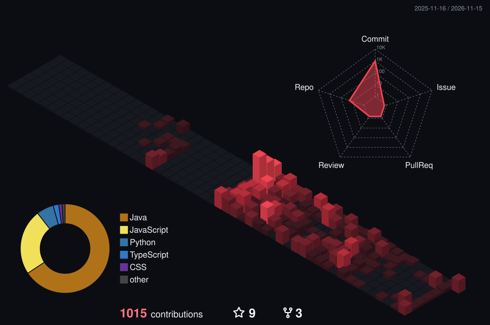

 

 

## 01 // Operator Profile

<table>
<tr>
<td width="40%" valign="top"></td>
<td width="60%" valign="top">

I’m a third-year **Computer Science & Engineering student at PSIT Kanpur**, building across Java, backend systems, full-stack products, and applied AI.

I like taking a real problem from **first sketch → working system**: model the data, shape the API, build the interface, then tighten the details.

**Current coordinates:** Java and DSA · Spring Boot and PostgreSQL · React and Next.js · AI/LLM applications · geospatial systems.

> **Build it. Understand it. Then make it better.**

</td>
</tr>
</table>

<table>
<tr>
<td width="25%" valign="top"><b>01 / SHIP</b> Turn ideas into usable software, not just slides.</td>
<td width="25%" valign="top"><b>02 / MODEL</b> Make the data and system boundaries clear.</td>
<td width="25%" valign="top"><b>03 / EXPLAIN</b> Keep AI-assisted decisions understandable.</td>
<td width="25%" valign="top"><b>04 / REFINE</b> Learn from the first version and improve it.</td>
</tr>
</table>

## 02 // Animated Readouts

## 03 // Systems in the Field

<table>
<tr>
<td width="48%" valign="top"></td>
<td width="52%" valign="middle"><h3>RailSage AI · Railway Operations</h3>
Team project for <b>FAR AWAY Hackathon 2026</b>. An operator-facing dashboard with live map tracking, multilingual announcements, and a step-by-step Claude reasoning feed.

<b>React 19 · Vite · Node.js · Express · Leaflet · GSAP</b>

<a href="https://railsage-ai.vercel.app">Live demo</a> · <a href="https://github.com/indeedvaibhav/railsage-ai">Source</a>
</td>
</tr>
</table>

<table>
<tr>
<td width="48%" valign="top"></td>
<td width="52%" valign="middle"><h3>CivicSentinel · Civic Intelligence</h3>
Citizen and admin workflows for civic complaints, AI-assisted classification, location-aware operations, and information retrieval.

<b>Civic tech · AI/LLM · RAG concepts · Geospatial data</b>
</td>
</tr>
</table>

 

### GramSetu · Village Infrastructure

A village-infrastructure digital twin concept for Panchayat planning, combining village-level data, analytics, and geospatial context.

**Decision support · Data visualization · Maps**

 

<table>
<tr>
<td width="48%" valign="top"></td>
<td width="52%" valign="middle"><h3>Orbitra · Satellite-to-Drone Verification</h3>
An energy-aware satellite-to-drone change-verification concept, shown with before/after imagery, AI-assisted prioritization, mission planning, and battery reserve awareness.

<b>Satellite change verification · AI-assisted planning · Energy-aware missions</b>
</td>
</tr>
</table>

<b>More builds</b> · ParkSense · eSwasthya · VarshaDrishti · Portfolio

- **ParkSense** — parking management workflows with a React/Next.js frontend and Spring Boot backend.
- **eSwasthya** — voice-first, multilingual healthcare interface concept focused on accessible navigation.
- **VarshaDrishti** — data and visualization project focused on turning information into useful insights.
- **Personal portfolio** — Next.js and TypeScript. [Live site](https://vaibhav-portfolio-o412.vercel.app/) · [Source](https://github.com/indeedvaibhav/poertfolio)

## 04 // Toolchain

<table>
<tr><th>Languages</th><th>Frontend</th><th>Backend</th><th>Data</th><th>AI / ML</th><th>Infrastructure</th></tr>
<tr>
<td align="center"> Java</td>
<td align="center"> React</td>
<td align="center"> Spring Boot</td>
<td align="center"> PostgreSQL</td>
<td align="center"> AI / ML</td>
<td align="center"> Git</td>
</tr>
<tr>
<td align="center"> Python</td>
<td align="center"> Next.js</td>
<td align="center"> Node.js</td>
<td align="center"> MySQL</td>
<td align="center"> LLM APIs</td>
<td align="center"> GitHub</td>
</tr>
<tr>
<td align="center"> JavaScript</td>
<td align="center"> Vite</td>
<td align="center"> Express</td>
<td align="center">▱ JPA / Hibernate</td>
<td align="center">⌘ RAG</td>
<td align="center"> AWS</td>
</tr>
<tr>
<td align="center"> TypeScript</td>
<td align="center"> Tailwind CSS</td>
<td align="center"> FastAPI</td>
<td align="center">↔ REST APIs</td>
<td align="center">◎ Geospatial AI</td>
<td align="center"> Vercel</td>
</tr>
<tr>
<td align="center"> HTML / CSS</td>
<td align="center">◌ GSAP</td>
<td align="center">⇄ REST APIs</td>
<td align="center">⌖ Geospatial data</td>
<td align="center">✳ Prompt engineering</td>
<td align="center">  Postman · VS Code</td>
</tr>
</table>

*Core problem-solving: Data Structures & Algorithms (DSA) · backend engineering · data modeling.*

## 05 // Hackathons

**12 hackathons led** — from national finals to international semi-finals. Selected events:

| Event | Role / result | Venue / track |
|:---|:---|:---|
| **India Innovates 2026** | Team lead · Finalist | Bharat Mandapam, New Delhi |
| **FAR AWAY 2026 (Zuup)** | Team lead · Semi-finalist | Delhi → Japan finale |
| **Smart India Hackathon 2026** | Team member | ISRO problem track |
| **National AI/ML Hackathon (AVEVA)** | Team lead | IIT Hyderabad · YUVAAN 2026 |
| **Hack It Out — Technex ’26** | Team lead | IIT BHU, Varanasi |
| **Hack for Green Bharat** | Team lead | Microsoft Office, Gurugram |
| **iQOO Hackathon 2026** | Team lead | Bengaluru · Pune · Chennai · Hyderabad |

## 06 // Education

| Programme | Institution | Result | Period |
|:---|:---|:---:|:---:|
| **B.Tech, Computer Science & Engineering** | Pranveer Singh Institute of Technology, Kanpur | **CGPA 7** · 3rd year | 2024–2028 |
| **ISC — Class XII (PCM)** | St. Thomas School, Kanpur | 83.4% · Sports Captain | 2023–2024 |
| **ICSE — Class X** | St. Thomas School, Kanpur | 91.2% · House Captain | 2021–2022 |

## 07 // Telemetry

<a href="https://leetcode.com/u/Indeedvaibhav/">Open LeetCode profile ↗</a>

## 08 // Base + Current Direction

| Base | Current focus |
|:---|:---|
| **B.Tech, Computer Science & Engineering** · PSIT Kanpur | Java DSA · backend architecture · database design |
| **3rd year** · Kanpur, Uttar Pradesh, India | Spring Boot + PostgreSQL · React / Next.js |
| **Open to** internships, hackathons, and open-source collaboration | AI/LLM applications · RAG · geospatial systems |

## 09 // Make Contact

**Have a useful problem to solve or a team to build with?**

[Portfolio](https://vaibhav-portfolio-o412.vercel.app/) · [LinkedIn](https://www.linkedin.com/in/vaibhav-tripathi-919939339) · [GitHub](https://github.com/indeedvaibhav) · [Email](mailto:indeedvaibhav@gmail.com)

