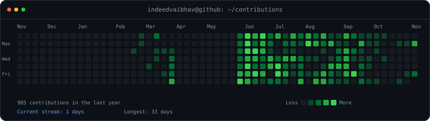
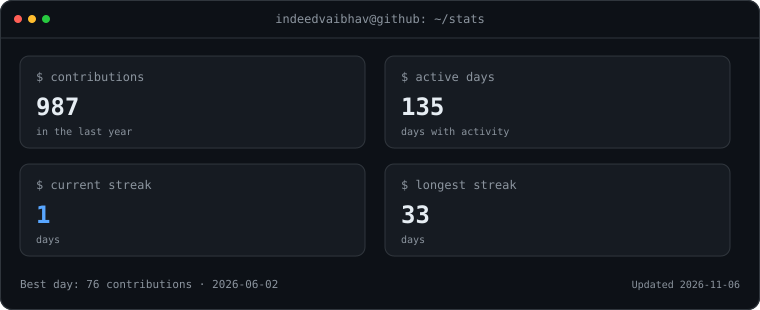
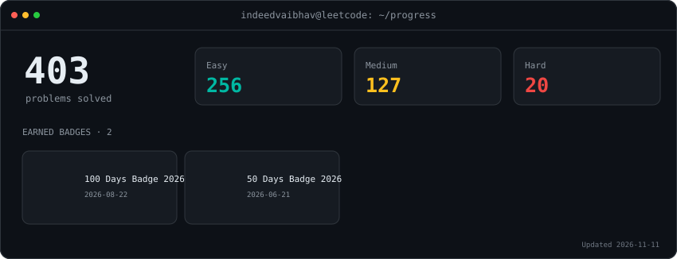

<div align="center">

<h3><code>vaibhav@github:~$ ./contributions.sh</code></h3>



<br/><br/>

<h3><code>vaibhav@github:~$ ./whoami.sh</code></h3>



<br/><br/>

<h3><code>vaibhav@github:~$ ./leetcode.sh</code></h3>

<a href="https://leetcode.com/u/Indeedvaibhav/"></a>

<br/><br/>

<h3><code>vaibhav@github:~$ ./links.sh</code></h3>

<p align="center">
  <a href="https://vaibhav-portfolio-o412.vercel.app/"></a>
  <a href="https://www.linkedin.com/in/vaibhav-tripathi-919939339"></a>
  <a href="https://github.com/indeedvaibhav"></a>
  <a href="https://leetcode.com/u/Indeedvaibhav/"></a>
  <a href="mailto:indeedvaibhav@gmail.com"></a>
</p>

</div>

<br/>

## 🧠 About Me

🎓 3rd-year B.Tech Computer Science & Engineering undergraduate at **PSIT Kanpur**

☕ My core strength is **Java** — focused on DSA, problem solving, backend development, and building strong programming fundamentals

⚙️ Building backend systems with **Spring Boot, REST APIs, PostgreSQL, JPA/Hibernate, and relational data modeling**

🌐 Building full-stack applications with **React, Next.js, TypeScript, Node.js, Express, and modern web tooling**

🤖 Exploring **Machine Learning, AI-powered applications, LLM APIs, RAG concepts, and data-driven systems**

🛰️ Built projects across **civic-tech, healthcare, railway operations, geospatial systems, village infrastructure, and productivity platforms**

🚀 From hackathon prototypes to backend systems, I like turning problem statements into **working software rather than just demos**

💻 I use **Java** as my primary language for DSA and problem-solving

📞 Open to **software engineering internships, hackathons, collaborative engineering, and open-source projects**

<br/>

```yaml
identity: "CSE Undergraduate | Java & DSA | Backend & Full-Stack Development"

currently:
  building:
    - "Spring Boot + PostgreSQL backend systems"
    - "AI-powered civic-tech & real-world applications"
    - "React / Next.js interfaces"

  strengthening:
    - "DSA in Java"
    - "Backend Engineering"
    - "Database Design"
    - "Machine Learning"

  exploring:
    - "AI / LLM applications"
    - "RAG & intelligent systems"
    - "System Design"
    - "Geospatial applications"

philosophy: "Build it. Understand it. Then make it better."
```

<br/>

## ⚡ Current Engineering Focus

<div align="center">

| Area               | Focus                                              |
| ------------------ | -------------------------------------------------- |
| 💻 Problem Solving | Java · DSA · LeetCode                              |
| ⚙️ Backend         | Spring Boot · REST APIs · Node.js · FastAPI        |
| 🌐 Frontend        | React · Next.js · TypeScript · Tailwind CSS        |
| 🗄️ Databases      | PostgreSQL · MySQL · SQL · JPA/Hibernate           |
| 🤖 AI / ML         | Python · Machine Learning · LLM APIs · RAG         |
| 🗺️ Specialized    | Geospatial systems · Maps · Data-driven dashboards |
| 🔧 Engineering     | Git · GitHub · API design · Database modeling      |

</div>

<br/>

## 🎓 Education

<div align="center">

|               |                                        |
| ------------- | -------------------------------------- |
| **Degree**    | B.Tech, Computer Science & Engineering |
| **Institute** | PSIT Kanpur                            |
| **Year**      | 3rd Year                               |
| **Location**  | Kanpur, Uttar Pradesh, India           |

</div>

<br/>

## 🛠️ Tech Stack

<table align="center">
  <tr>
    <th>Languages</th>
    <th>Frontend</th>
    <th>Backend / Data</th>
  </tr>

  <tr>
    <td align="center">
      <br/>Java
    </td>
    <td align="center">
      <br/>React
    </td>
    <td align="center">
      <br/>Spring Boot
    </td>
  </tr>

  <tr>
    <td align="center">
      <br/>JavaScript
    </td>
    <td align="center">
      <br/>Next.js
    </td>
    <td align="center">
      <br/>Node.js
    </td>
  </tr>

  <tr>
    <td align="center">
      <br/>TypeScript
    </td>
    <td align="center">
      <br/>Tailwind CSS
    </td>
    <td align="center">
      <br/>Express
    </td>
  </tr>

  <tr>
    <td align="center">
      <br/>Python
    </td>
    <td align="center">
      <br/>Vite
    </td>
    <td align="center">
      <br/>FastAPI
    </td>
  </tr>

  <tr>
    <td align="center">
      <br/>HTML / CSS
    </td>
    <td align="center">
      <br/>Maps / Leaflet
    </td>
    <td align="center">
      <br/>PostgreSQL
    </td>
  </tr>

  <tr>
    <td align="center">
      <br/>SQL / MySQL
    </td>
    <td align="center">
      <b>REST APIs</b><br/>API Design
    </td>
    <td align="center">
      <b>JPA / Hibernate</b><br/>ORM
    </td>
  </tr>

  <tr>
    <td align="center">
      <br/>Git
    </td>
    <td align="center">
      <br/>GitHub
    </td>
    <td align="center">
      <br/>IntelliJ IDEA
    </td>
  </tr>

  <tr>
    <td align="center">
      <br/>VS Code
    </td>
    <td align="center">
      <b>AI / ML</b><br/>LLM APIs · RAG
    </td>
    <td align="center">
      <b>Data</b><br/>Analytics · Modeling
    </td>
  </tr>
</table>

<p align="center">
  <sub>Building across Java backend engineering, modern web development, databases, AI/ML and geospatial applications.</sub>
</p>

<br/>

## 📌 Pinned Repositories

<div align="center">

| Repository                                                         | Description                                                                  |
| ------------------------------------------------------------------ | ---------------------------------------------------------------------------- |
| 🚂 **[railsage-ai](https://github.com/indeedvaibhav/railsage-ai)** | AI-assisted railway operations dashboard — FAR AWAY Hackathon 2026           |
| 💼 **[poertfolio](https://github.com/indeedvaibhav/poertfolio)**   | Personal portfolio — Next.js + TypeScript, deployed on Vercel                |
| 🧠 **CivicSentinel**                                               | AI-powered civic intelligence platform with citizen/admin workflows          |
| 🩸 **BloodFlow**                                                   | Blood donation coordination backend — Spring Boot + PostgreSQL               |
| 🌾 **GramSetu**                                                    | AI-powered village infrastructure digital twin for Panchayat decision-making |
| 💻 **[LeetCode](https://github.com/indeedvaibhav/LeetCode)**       | Auto-synced repository of my LeetCode solutions in Java                      |

</div>

<br/>

## 🚀 Featured Projects

### 🧠 CivicSentinel — AI Civic Intelligence Platform

An AI-driven civic-tech platform designed around citizen complaints, administrative workflows, geospatial context, and intelligent decision support.

* Built separate **Citizen and Admin experiences** for reporting, tracking, and operational management
* Worked with **AI-assisted classification and intelligent information retrieval**
* Integrated **geospatial visualization** for location-aware civic data
* Explored **RAG, knowledge-driven retrieval, and AI-assisted workflows**
* Designed the system around a real-world civic problem rather than a generic CRUD use case

<br/>

### 🌾 GramSetu — Village Infrastructure Digital Twin

An AI-powered civic-tech concept designed to help Panchayat officers understand infrastructure gaps and make better development investment decisions.

* Combines **village-level data, analytics, and geospatial context**
* Designed around the concept of a **digital twin for village infrastructure**
* Focuses on turning fragmented information into actionable planning insights
* Built with a dashboard-first approach for decision makers
* Developed as a hackathon-oriented real-world problem-solving project

<br/>

### 🩸 BloodFlow — Blood Donation Coordination Platform

A backend-focused healthcare platform for connecting **donors, hospitals, blood requests, and donor responses**.

* Backend built with **Spring Boot**
* Uses **PostgreSQL** with a relational domain model
* Designed separate entities/tables for users, donors, hospitals, blood requests, and donor responses
* Worked through relational modeling, entity relationships, constraints, and persistence with **JPA/Hibernate**
* Built while focusing on proper backend architecture rather than simply creating CRUD endpoints

<br/>

### 🚂 RailSage AI — Railway Operations Dashboard *(Team Project)*

🔗 **Live:** [railsage-ai.vercel.app](https://railsage-ai.vercel.app) · **Repo:** [View Source](https://github.com/indeedvaibhav/railsage-ai)

Built for the **FAR AWAY Hackathon 2026** as part of a team using **React 19, Vite, Node.js, Express, Leaflet, and GSAP**.

* Integrated the **Anthropic Claude API** to power a step-by-step reasoning feed for operator-facing AI decisions
* Implemented **live map-based tracking** using Leaflet
* Added multilingual announcement support across **English, Hindi, and Japanese**
* Used **GSAP** for transitions across a data-dense operations dashboard
* Focused on making AI-assisted operational decisions more transparent rather than treating AI as a black box

<br/>

### 🅿️ ParkSense — Parking Management System

A full-stack parking management platform built around administrative workflows and public-facing parking information.

* Built the frontend with **React / Vite and Next.js**
* Worked with **Tailwind CSS** for the interface
* Backend architecture using **Spring Boot**
* Database-backed parking, slot, and management workflows
* Focused on turning a real operational problem into a complete software system

<br/>

### 🩺 eSwasthya — Voice-First Healthcare Interface

A voice-first healthcare application concept designed with elderly users in mind.

* Built around the **Web Speech API**
* Supports voice interaction and speech synthesis concepts
* Designed multilingual patient-oriented navigation
* Focused heavily on accessibility and reducing dependence on conventional touch-based interfaces
* Developed as a practical exploration of voice-first UX

<br/>

### 🌱 VarshaDrishti — Data & Intelligence Project

A project exploring how data, analytics, and technology can be used to turn real-world information into meaningful visual insights.

* Data-oriented problem solving
* Dashboard and visualization thinking
* Designed around practical interpretation rather than raw datasets alone

<br/>

### 💼 Personal Portfolio

🔗 **Live:** [vaibhav-portfolio-o412.vercel.app](https://vaibhav-portfolio-o412.vercel.app/) · **Repo:** [View Source](https://github.com/indeedvaibhav/poertfolio)

Built with **Next.js and TypeScript**, with a focus on presenting projects, technical work, and engineering interests through a custom interface.

<br/>

## 🏆 Achievements & Milestones

<div align="center">

| Recognition                    | Details                                                                                       |
| ------------------------------ | --------------------------------------------------------------------------------------------- |
| 💻 **LeetCode Practice**       | Java-focused problem solving and DSA practice                                                 |
| 🏆 **Hackathon Projects**      | Collaborative development across AI, civic-tech, healthcare and real-world problem statements |
| 🚂 **FAR AWAY Hackathon 2026** | Built RailSage AI as a team project                                                           |
| 🧠 **AI / ML Learning**        | AWS-focused Machine Learning & AI learning track                                              |
| 🛠️ **Project Building**       | Multiple deployed and prototype systems across full-stack, backend and AI domains             |

</div>

<br/>

## 💻 LeetCode

I practice data structures and algorithms in Java. [View my LeetCode profile](https://leetcode.com/u/Indeedvaibhav/).

<br/>

## 🎯 What I'm Focused On

<div align="center">

| Area              | Focus                                                           |
| ----------------- | --------------------------------------------------------------- |
| 📚 Learning       | Machine Learning · Backend Architecture · System Design         |
| 🏗️ Building      | Spring Boot + PostgreSQL systems · React / Next.js applications |
| 🤖 Exploring      | AI / LLM applications · RAG · Intelligent systems               |
| 🗺️ Experimenting | Geospatial applications · Data-driven dashboards                |
| 💻 Practicing     | DSA in Java · LeetCode · Problem Solving                        |
| 🎯 Open To        | Software Engineering Internships · Hackathons · Open Source     |

</div>

<br/>

## 🧭 Engineering Interests

<div align="center">

`Java` · `DSA` · `Spring Boot` · `REST APIs` · `PostgreSQL` · `React` · `Next.js` · `Python` · `AI/ML` · `RAG` · `Geospatial Systems`

</div>

<br/>

## 📧 Connect With Me

<p align="center">
  <a href="https://www.linkedin.com/in/vaibhav-tripathi-919939339" target="_blank"></a>
  <a href="https://github.com/indeedvaibhav" target="_blank"></a>
  <a href="mailto:indeedvaibhav@gmail.com" target="_blank"></a>
  <a href="https://vaibhav-portfolio-o412.vercel.app/" target="_blank"></a>
</p>

<br/>

<div align="center">

### 🔴 "Code is compiled discipline."


</div>
